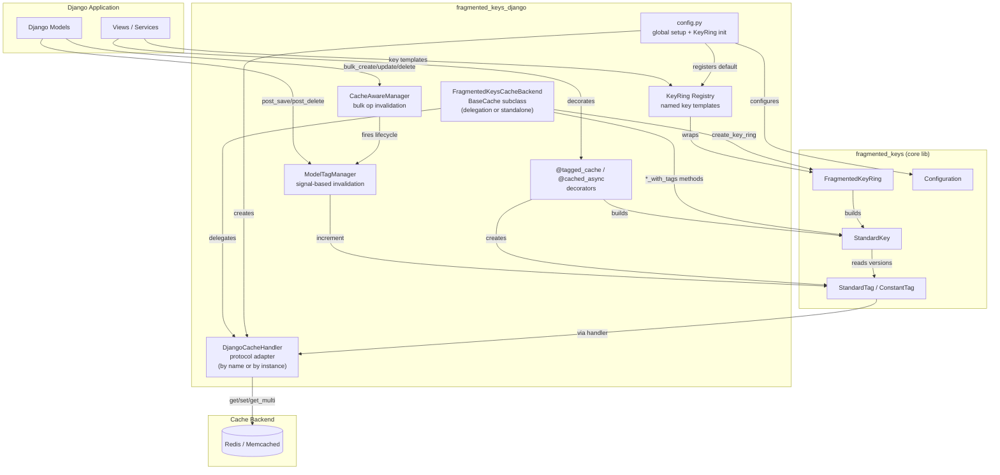

# Project Architecture

## Overview

`fragmented-keys-django` (v0.2.0) is a Django integration layer for the [`fragmented-keys`](https://pypi.org/project/fragmented-keys/) library. It provides tag-versioned cache invalidation: cache keys are composed from tag versions, so incrementing a tag automatically invalidates every key that depends on it. The package offers three usage modes: a drop-in Django cache backend, decorators/helpers for wrapping individual functions, and a KeyRing registry for centrally defined key templates.

## System Diagram

## Core Components

| Component | Module | Purpose |
|-----------|--------|---------|
| `DjangoCacheHandler` | `cache_backends.handlers` | Adapts Django's cache API to the `fragmented_keys.CacheHandler` protocol. Supports construction by cache alias name (delegation) or by cache instance (standalone). |
| `FragmentedKeysCacheBackend` | `cache_backends.django_backend` | Drop-in `BaseCache` subclass with two config modes: **delegation** (`CACHE_NAME` → wraps existing alias) or **standalone** (`LOCATION` → owns its own connection). Provides `*_with_tags` methods and `create_key_ring()`. |
| `@tagged_cache` | `cache_utils.decorators` | Sync function decorator — builds `StandardKey` from tag templates and `vary_on` params |
| `@cached_async` | `cache_utils.decorators` | Async version of `@tagged_cache` for `async def` functions |
| `ModelTagManager` | `cache_utils.model_helpers` | Connects `post_save`/`post_delete` signals to auto-increment tags. Provides `invalidate_scope()`, `invalidate_bulk()`, `invalidate_model_tag()`. |
| `CacheAwareManager` | `cache_utils.bulk` | Custom `Manager`/`QuerySet` that fires tag invalidation on `bulk_create`, `bulk_update`, `QS.delete()`, `QS.update()` — operations that bypass Django signals. |
| `KeyRing Registry` | `cache_utils.key_rings` | Global named registry for `FragmentedKeyRing` instances. `register_key_ring()`, `get_key_ring()`, `clear_key_rings()`. |
| Tag factories | `cache_utils.tags` | `model_tag()`, `list_tag()`, `aggregate_tag()`, `constant_tag()`, `custom_tag()` — convenience constructors. Plus `parse_tag_template()`, `resolve_tag_instance()`, `build_composite_key()` utilities. |
| `configure_fragmented_keys()` | `config` | One-call global setup (handler + prefix + default KeyRing); call in `AppConfig.ready()` |
| `reset_configuration()` | `config` | Resets global handler, prefix, and key ring registry — for test teardowns |

## Three Usage Modes

### 1. Decorator Mode
Wrap individual functions with `@tagged_cache(tags=[...], vary_on=[...])` or `@cached_async(...)` for surgical, per-function caching with fine-grained tag dependencies.

### 2. Backend Mode
Configure `FragmentedKeysCacheBackend` in `CACHES` and use `*_with_tags` methods directly: `set_with_tags()`, `get_with_tags()`, `get_or_set_with_tags()`, `delete_with_tags()`, `invalidate_tags()`, `get_tag_version()`.

### 3. KeyRing Mode
Define key templates centrally in `AppConfig.ready()`, retrieve them in views to build composite cache keys. Templates are defined once; key objects are constructed from them with instance values.

→ *See [arch/data-flow.md](arch/data-flow.md) for sequence diagrams*

## Bulk Operation Support

Django's `bulk_create`, `bulk_update`, `QuerySet.delete()`, and `QuerySet.update()` bypass `post_save`/`post_delete` signals. `CacheAwareManager` and `CacheAwareQuerySet` wrap these methods to fire `ModelTagManager._fire_lifecycle` after the operation completes.

**Trade-off**: `CacheAwareQuerySet.delete()` and `.update()` fetch all affected PKs before executing (one extra SELECT). For very large querysets, use `ModelTagManager.invalidate_bulk()` directly.

## Configuration API

| Function | Scope | Purpose |
|----------|-------|---------|
| `configure_fragmented_keys()` | Global | One-call setup: handler + prefix + default KeyRing |
| `reset_configuration()` | Global | Reset all state (tests) |
| `get_cache_handler()` | Per-call | Get handler for a specific cache alias without modifying global state |
| `set_cache_handler_globally()` | Global | Switch backing cache after initial config |
| `set_global_prefix()` | Global | Change prefix (effectively busts all tag-based caches) |
| `get_global_prefix()` | Per-call | Read current prefix |

## Key Design Decisions

- **Tag-version invalidation over explicit delete**: Avoids scanning/deleting individual keys; a single `INCR` invalidates all dependent entries.
- **Protocol adapter pattern**: `DjangoCacheHandler` bridges Django's cache API and `fragmented_keys.CacheHandler`, keeping the core library backend-agnostic.
- **Dual backend config**: `FragmentedKeysCacheBackend` supports **delegation** (`CACHE_NAME` → wraps an existing `CACHES` alias, shares its connection pool) and **standalone** (`LOCATION` → instantiates its own backend via `BACKEND_CLASS`). Delegation preserves LocMemCache testability; standalone simplifies single-entry config.
- **Three usage modes**: Backend mode for broad coverage; decorator mode for surgical per-function caching; KeyRing mode for centrally managed key templates.
- **Signal-driven auto-invalidation**: `ModelTagManager` uses Django signals so model changes invalidate cache without manual intervention.
- **Bulk operation gap-filling**: `CacheAwareManager` addresses Django's signal gap for bulk operations with an explicit extra-SELECT trade-off.
- **Observability-dark by default**: No built-in logging/metrics/tracing. Clean subclass hooks (`_build_tagged_key`, `invalidate_tags`) for users to layer in StatsD, Prometheus, or OpenTelemetry. See `docs/usage/telemetry.rst`.
- **Recursion guard in config**: `configure_fragmented_keys()` detects when the named cache IS a `FragmentedKeysCacheBackend` (whose `__init__` already registered a handler) and reuses the existing handler to avoid infinite recursion.

## Technology Stack

| Layer | Technology |
|-------|-----------|
| Language | Python 3.11+ |
| Framework | Django 5.0+ |
| Cache backend | Django's built-in `RedisCache` (django-redis optional) |
| Core library | fragmented-keys >= 0.1.3 |
| Testing | pytest, pytest-django, pytest-cov (~270 tests) |
| Documentation | Sphinx, Read the Docs |
| Package tooling | uv, setuptools |
